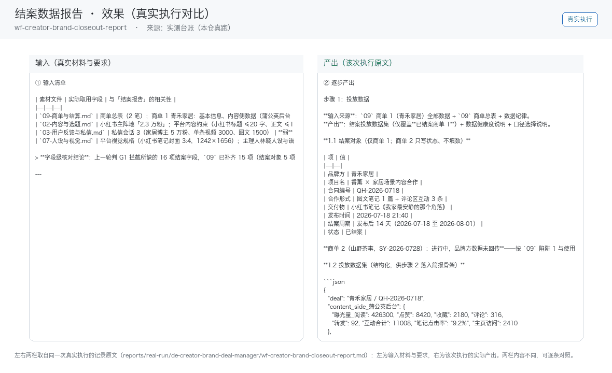
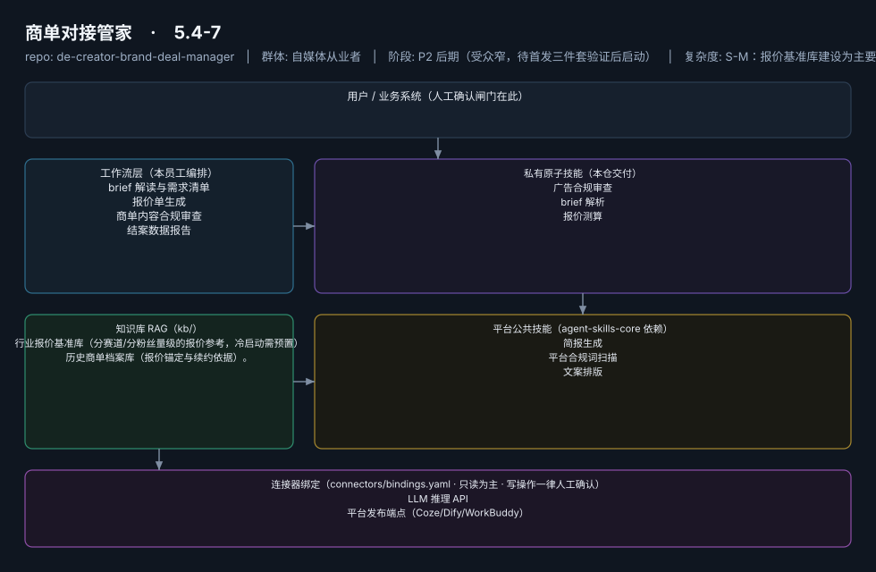

# 商单对接管家

> 帮中腰部博主建立报价体系、不再贱卖流量的商务助理
>
> **5.4-7**　·　自媒体从业者　·　阶段 P2 后期（受众窄，待首发三件套验证后启动）　·　
> 复杂度 S-M：报价基准库建设为主要工作量，总估 5-8 人日　·　¥50-100/月或按单付费（据 R2 调研）　·　定义卡 5.4-7

## 演示（真实执行录播）



*真实执行回放（GIF 自动循环，非摆拍）· [▶ 观看完整版 MP4](workflows/wf-creator-brand-closeout-report/docs/images/08-demo-run.mp4) · 台账见 [`reports/real-run/wf-creator-brand-closeout-report.md`](reports/real-run/wf-creator-brand-closeout-report.md)*



## 效果（真实执行）


*上图为**真实效果对比**，不是示意图：左栏是输入材料与要求，右栏是该次执行的产出原文，
两栏取自同一次真实执行记录。*

- 完整台账：[`reports/real-run/wf-creator-brand-closeout-report.md`](reports/real-run/wf-creator-brand-closeout-report.md)
- 录屏与终端回放：[`workflows/wf-creator-brand-closeout-report/docs/images/`](workflows/wf-creator-brand-closeout-report/docs/images/)（`08-demo-run.gif` / `08-demo-run.mp4` / `04-terminal-run.png`）
- 使用示例：[`workflows/wf-creator-brand-closeout-report/docs/使用示例.md`](workflows/wf-creator-brand-closeout-report/docs/使用示例.md)
> 实测判定：**通过**　·　可用度 4/5　·　编造数字 0 处　·　红线命中 2 次 / 拦截 2 次


**一句话**：有商单能力的腰部以上创作者（受众较窄，据 R2 调研痛点 #8）

---

## 这个数字员工解决什么问题

帮中腰部博主建立报价体系、不再贱卖流量的商务助理

| 项 | 内容 |
|---|---|
| 服务对象 | 有商单能力的腰部以上创作者（受众较窄，据 R2 调研痛点 #8） |
| 可量化目标 | 报价响应时长从 days 缩至 hours；商单合规审查覆盖率 100%；结案报告交付率 100%（直接挂钩续约率） |
| 投入产出 | 直接工时节省有限（月约 6h），核心价值在报价合理化增收与合规止损，适合按单付费 |
| 需求依据 | D05、D10 |
| 分发渠道 | GitHub（必备基础渠道）、小红书、闲鱼、淘宝（报价模板/结案模板适配货架电商按单售卖）、千问办公 |

## 30 秒上手

```bash
git clone <本仓库地址> && cd de-creator-brand-deal-manager
pip install pyyaml
python3 tests/run.py            # 先跑一遍自检，确认环境与契约都对得上
```

试用（把 `<输入>` 换成本人真实材料）：

```text
请以「商单对接管家」的身份，帮我跑「brief 解读与需求清单」。
材料如下：<输入>
要求：只使用材料里出现过的数字，缺的写 <待填>；对外文案停在待确认状态。
```

详细接入见 [`docs/01-安装与接入.md`](docs/01-安装与接入.md)。

## 仓库结构

```text
de-creator-brand-deal-manager/
├── employee.md            # 人读定义卡（12 主字段 + 2 扩展组，由 employee.yaml 生成）
├── employee.yaml          # 机器契约（能力清单 + 依赖锁）
├── dependencies.yaml      # 对 core 的外部依赖（含版本）
├── persona/               # 运行提示词 / 边界 / KPI
├── skills/                # 私有原子技能（3 个）
├── spec-bindings/         # 有意不公共化能力的本地绑定声明（0 个）
├── workflows/             # 本员工工作流（4 条）
├── kb/                    # 知识库 RAG 契约
├── connectors/            # 连接器绑定（只读为主，写操作人工确认）
├── docs/                  # 六类发布文档
└── tests/                 # 自动化多场景测试
```

## 私有原子技能（3）

| 技能 | slug | 复杂度 | 阶段 | 成熟度 |
|---|---|---|---|---|
| `广告合规审查` | `ad-compliance-review` | M | P2 | 契约完备 |
| `brief 解析` | `brief-parser` | S | P2 | 契约完备 |
| `报价测算` | `quote-calculator` | M | P2 | 契约完备 |

## 平台公共技能依赖（3）

| 技能 | slug | 全平台复用员工数 |
|---|---|---|
| `简报生成` | `brief-generator` | 10 |
| `平台合规词扫描` | `compliance-word-scan` | 6 |
| `文案排版` | `copy-layout` | 2 |

> 这些技能来自 `agent-skills-core@1.0.0`，本仓库**只引用不复制**。

## Spec 绑定层（0）

（无）

> 这一族能力**有意不公共化**（与外部平台接口强绑定）。本仓不存正文，
> 只留本地绑定声明与连接器配置。

## 工作流（4）

| 工作流 | slug | 触发 | 阶段 | 调用技能数 |
|---|---|---|---|---|
| `brief 解读与需求清单` | `wf-creator-brand-registry` | 事件（收到 brief） | P2 | 1 |
| `报价单生成` | `wf-creator-brand-quote` | 人工 | P2 | 1 |
| `商单内容合规审查` | `wf-creator-brand-compliance` | 事件（交稿前） | P2 | 2 |
| `结案数据报告` | `wf-creator-brand-closeout-report` | 事件（结案） | P2 | 2 |

## 知识库与连接器

- 知识库语料：['行业报价基准库（分赛道/分粉丝量级的报价参考，冷启动需预置）', '历史商单档案库（报价锚定与续约依据）。']
- 连接器：LLM 推理 API、平台发布端点（Coze/Dify/WorkBuddy）

## 质量与验收

| 项 | 值 |
|---|---|
| 技能文件数 | 154 |
| 多场景用例数 | 206 |
| 用例通过 | 206 |
| 验收结论 | ✅ 通过 |

完整报告：[`docs/05-验收与测试.md`](docs/05-验收与测试.md)

## 许可

专有许可，详见 [`LICENSE`](LICENSE)。
