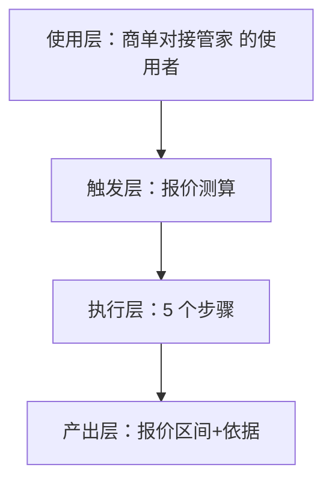
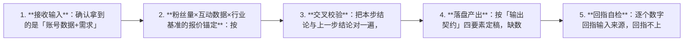

# 报价测算 · 架构与流程图

## 本技能的四层结构

| 层 | 内容 |
|---|---|
| 使用层 | 有商单能力的腰部以上创作者（受众较窄，据 R2 调研痛点 #8）；员工定位：帮中腰部博主建立报价体系、不再贱卖流量的商务助理 |
| 触发层 | 关键词 / 显式点名「报价测算」；触发方式：用户提出需求 |
| 执行层 | **接收输入**：确认拿到的是「账号数据+需求」，先做完整性检查。 → **粉丝量×互动数据×行业基准的报价锚定**：按该定义执行，并把用到的输入项显式写进产出。 → **交叉校验**：把本步结论与上一步结论对一遍，出现矛盾先解决矛盾再往下走。 → **落盘产出**：按「输出契约」四要素定稿，缺数据的写 `<待填>`。 → **回指自检**：逐个数字回指输入来源，回指不上的删掉。 |
| 产出层 | 报价区间+依据 |

## 执行流程

## 步骤职责表

| # | 步骤 | 承担者 | 为什么 |
|---|---|---|---|
| 1 | **接收输入**：确认拿到的是「账号数据+需求」，先做完整性检查。 | 模型 | 需要读懂语境，不可用固定规则替代 |
| 2 | **粉丝量×互动数据×行业基准的报价锚定**：按该定义执行，并把用到的输入项显式写进产出。 | 模型 | 需要读懂语境，不可用固定规则替代 |
| 3 | **交叉校验**：把本步结论与上一步结论对一遍，出现矛盾先解决矛盾再往下走。 | 模型 | 需要读懂语境，不可用固定规则替代 |
| 4 | **落盘产出**：按「输出契约」四要素定稿，缺数据的写 `<待填>`。 | 模型 | 需要读懂语境，不可用固定规则替代 |
| 5 | **回指自检**：逐个数字回指输入来源，回指不上的删掉。 | 模型 | 需要读懂语境，不可用固定规则替代 |

⚠️ 尚未补齐：图中的步骤来自注册表口径，未逐条实跑校验；实跑后请同步修订本页（`发布标准.md` 第六项：通读一遍，不得出现重复填充句）。
