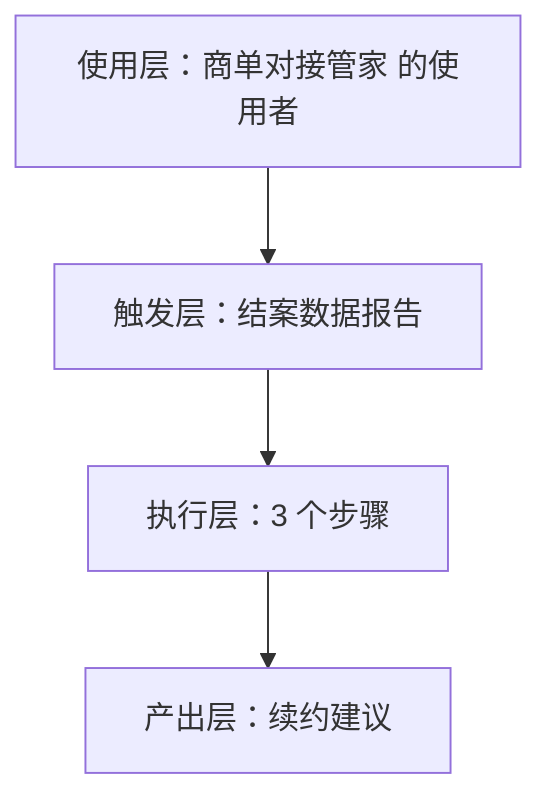
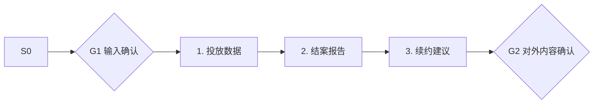

# 结案数据报告 · 架构与流程图

## 本工作流的四层结构

| 层 | 内容 |
|---|---|
| 使用层 | 有商单能力的腰部以上创作者（受众较窄，据 R2 调研痛点 #8）；员工定位：帮中腰部博主建立报价体系、不再贱卖流量的商务助理 |
| 触发层 | 关键词 / 显式点名「结案数据报告」；触发方式：事件（结案） |
| 执行层 | 投放数据 → 结案报告 → 续约建议 |
| 产出层 | 续约建议 |

## 执行流程

## 步骤职责表

| # | 步骤 | 承担者 | 为什么 |
|---|---|---|---|
| 1 | 投放数据 | 模型 | 需要读懂语境，不可用固定规则替代 |
| 2 | 结案报告 | 模型 | 需要读懂语境，不可用固定规则替代 |
| 3 | 续约建议 | 模型 | 需要读懂语境，不可用固定规则替代 |

⚠️ 尚未补齐：图中的步骤来自注册表口径，未逐条实跑校验；实跑后请同步修订本页（`发布标准.md` 第六项：通读一遍，不得出现重复填充句）。
